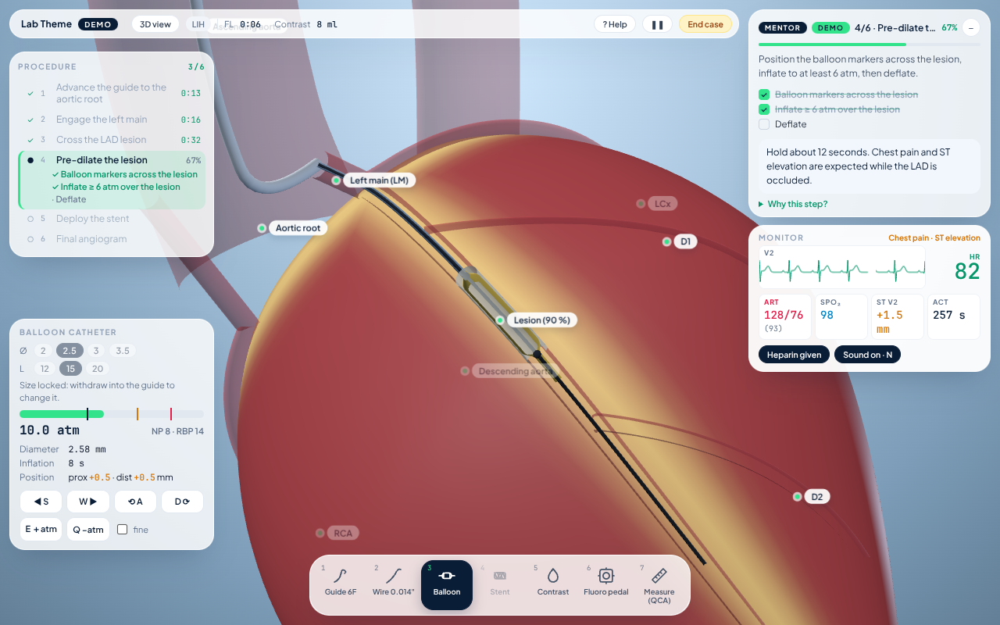
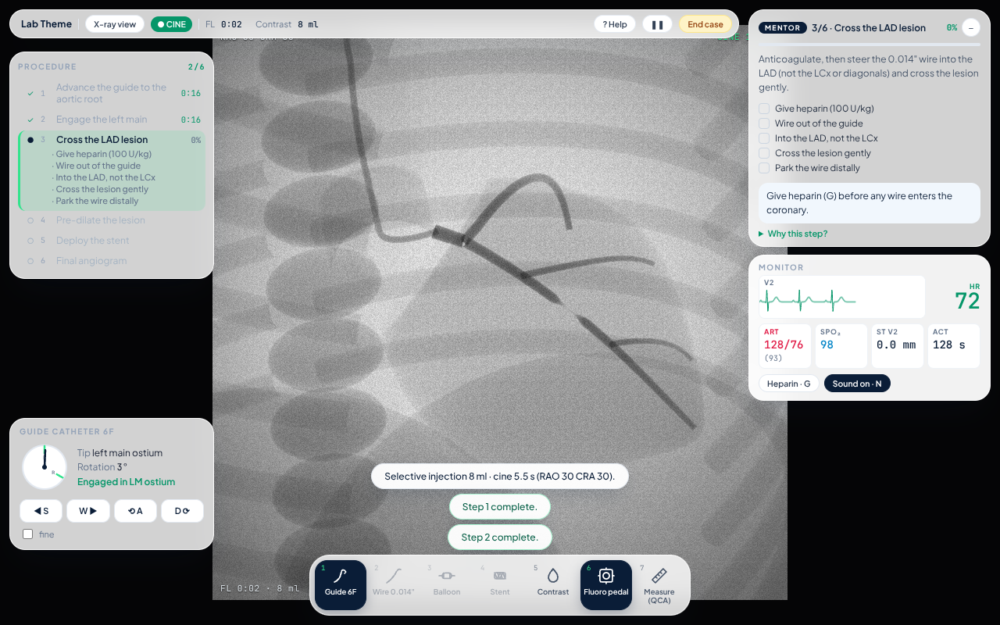
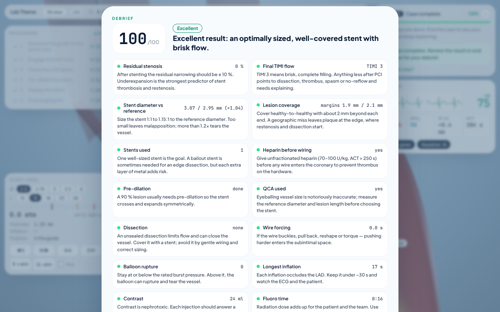

# Lab Theme



> **Solo para educación y demostración.** Lab Theme no es entrenamiento clínico, no es un dispositivo médico y no es consejo médico. La anatomía, los dispositivos y la fisiología están simplificados con fines didácticos.

Simulador educativo de **intervención coronaria percutánea (ICP)** en el navegador, para estudiantes de medicina: implantar un stent en una estenosis del 90 % de la **descendente anterior (DA) media** por **acceso radial derecho**.

**Pruébalo en línea:** https://marie-lucy.github.io/lab-sim/

```bash
npm install && npm run dev
```

**253 tests unitarios** (Vitest): `npm test` · build con chequeo de tipos: `npm run build`.

## Idiomas

La interfaz está en **español (Latinoamérica, es-419)**, **portugués (Brasil, pt-BR)** e **inglés**. Al abrirla se usa el idioma guardado o el del navegador. Se cambia en cualquier momento con el selector **ES · PT · EN** de la pantalla de inicio o el de la barra superior, y la elección queda guardada.

Se traduce todo: etapas, mentor, demo, mensajes, motivos de bloqueo, etiquetas anatómicas, monitor y debrief. Se usa la terminología de hemodinamia de cada idioma (TCI/TCE, DA, Cx, CD, TCA, proyecciones OAD/OAI y OAD/OAE) y los decimales del idioma (coma en portugués). Los tests verifican que los tres diccionarios tengan las mismas claves y los mismos parámetros, y que no queden textos sin traducir.

## Casos

En la pantalla de inicio se elige el paciente:

| Caso | Dificultad | Qué cambia |
|---|---|---|
| Lesión clásica de la DA media | Básico | Caso de referencia, siempre igual (90 %, 14 mm). Es el que usa la demo. |
| DA media, variante aleatoria | Básico | Posición, longitud (10–18 mm) y severidad (80–93 %) distintas en cada variante. |
| Lesión larga y difusa de la DA | Intermedio | 23–28 mm: obliga a medir bien; si no cabe en el stent más largo con margen, se usan dos stents superpuestos. |
| Estenosis crítica suboclusiva | Avanzado | 95–97 % con flujo lento: el paciente tiene isquemia antes de empezar. |
| Lesión intermedia de la DA (FFR) | Intermedio | Estenosis del 52–70 %: la angiografía no alcanza. Hay que medir la FFR y decidir si poner stent o diferir. |
| Lesión calcificada de la DA | Avanzado | Calcio que no deja expandir balones ni stents hasta que se fractura a ≥ 18 atm con un balón NC. Hay que verificar el stent con IVUS/OCT. |
| Lesión de la circunfleja media | Intermedio | El alambre sale apuntando a la DA y hay que llevarlo a la Cx; la isquemia se ve en V5. |
| Lesión de la coronaria derecha media | Intermedio | Hay que canular la cúspide derecha (120°); la inyección selectiva llena la CD y la isquemia se ve en la derivación II. |

Cada variante sale de una **semilla**: el mismo caso y la misma semilla dan siempre el mismo paciente. El enlace del navegador (`?case=longLad&seed=6Y6J`) permite compartir o repetir exactamente ese caso. En el debriefing, "Repetir este caso" vuelve a la misma variante. Los tests juegan varias variantes de cada caso con un operador guiado por QCA y comprueban que todas se pueden resolver.

## Fisiología: FFR

En el caso de **lesión intermedia** aparece una etapa más, después de cruzar la lesión: **Fisiología**. El alambre es una guía de presión, con el sensor en la punta. La herramienta **FFR (`8`)** da adenosina intracoronaria y mide Pd/Pa en hiperemia:

- La medición solo cuenta si el sensor queda **al menos 5 mm más allá de la lesión**. Si no, se muestra pero no sirve para decidir.
- Con **FFR ≤ 0.80**, la lesión limita el flujo: se carga un balón y el caso sigue como siempre.
- Con **FFR > 0.80**, lo correcto es **Diferir: no tratar** (botón del panel de FFR). El caso termina ahí, con tratamiento médico.

El debriefing agrega la **decisión fisiológica**, que pesa más que cualquier detalle técnico (45 puntos), como en los ensayos FAME y DEFER. Si se difirió, los ítems del stent salen como "no aplica". Se puede volver a medir después del stent: la FFR sube por encima de 0.90.

**Cómo se calcula.** La caída de presión a lo largo del vaso sigue la ecuación clásica de la estenosis, ΔP = F·Q + S·Q²:

- **F** es la fricción de Poiseuille, 8μ·Δs / (π·r⁴), sumada cada 0.25 mm del lumen hasta el sensor;
- **S** es la energía que se pierde cuando el chorro se vuelve a expandir después del punto más estrecho, ρ/2 · k · (1/A_mín − 1/A_ref)², con k = 1.52 (Young y Tsai).

La microcirculación en hiperemia es una resistencia fija R = Pa / Q_máx, con Pa = 90 mmHg y un Q_máx de 2 ml/s para la DA y 1.5 ml/s para la Cx y la CD. El flujo resuelve Pa = (F + R)·Q + S·Q², y FFR = Pd / Pa = Q·R / Pa. Con estos valores, el corte de 0.80 cae cerca del 61 % de estenosis en la DA, así que la mitad de las variantes del caso intermedio necesitan stent y la otra mitad no.

## Imagen intravascular: IVUS y OCT

Con el alambre distal y sin balón ni stent en la arteria, la herramienta **IVUS/OCT (`9`)** hace un *pullback*: recorre el vaso desde la punta del alambre hasta el ostium, con un corte cada 0.5 mm. El panel muestra:

- el **corte transversal** en el cursor, con lumen, placa, membrana elástica externa (MEE), struts del stent y flap de disección;
- la **vista longitudinal** del pullback, con un cursor que se arrastra;
- **antes del stent**: área luminal mínima (ALM) con su carga de placa, lumen de referencia proximal y distal, y un **stent sugerido** (diámetro y largo);
- **después del stent**: área mínima del stent (AMS), **expansión** (AMS / área media de referencia, meta ≥ 90 %), **mala aposición** máxima (meta < 0.4 mm) y bordes (disección o placa ≥ 50 % a 5 mm del borde).

**IVUS** ve toda la pared. **OCT** da más detalle y muestra la sombra de los struts, pero gasta 14 ml de contraste en el lavado y no ve la MEE detrás de placa de más de 1 mm. Por eso, en la lesión, la OCT no informa la carga de placa.

**Cómo se calcula** (`src/physics/imaging.ts`):

- La MEE es 1.15 × el diámetro de referencia sano (sin remodelado), así que la pared normal tiene ≈ 24 % de carga de placa: 1 − 1/1.15².
- La lesión son los cortes con carga de placa ≥ 50 % alrededor de la ALM. Las zonas de aterrizaje son los cortes casi normales (< 30 %) más cercanos, y las referencias son el lumen más grande en los 10 mm siguientes.
- El stent sugerido tiene un diámetro ≈ 1.05 × la media de las referencias (el tamaño disponible más cercano) y el largo más corto que va de una zona de aterrizaje a la otra, con 1.5 mm de margen a cada lado.
- Los struts están apuestos donde apoyan sobre placa. Donde la pared nativa es más ancha que el stent quedan separados: la mala aposición es (pared − stent) / 2.

El pullback es una acción grabada: se ve en la repetición y viaja en los archivos exportados.

## Calcio, balón no complaciente y optimización del stent

El panel del balón tiene un selector **SC / NC**:

- El **semicomplaciente (SC)** crece 1.5 % por atm, tiene presión nominal de 8 atm, RBP de 14 y se rompe a 18.
- El **no complaciente (NC)** crece solo 0.4 % por atm (presión nominal 12, RBP 20) y viene en 2.5–4.0 × 8/12/15 mm. Sirve para inflar a alta presión sin estirar el vaso más allá de su tamaño.

En la **lesión calcificada**, mientras el calcio está intacto, cualquier dispositivo llega solo al 55 % del camino entre el lumen nativo y su propio diámetro: lumen = nativo + (objetivo − nativo) × (1 − 0.45 × calcio). El calcio se **fractura** cuando un balón o stent se infla a **≥ 18 atm** sobre la lesión. Un SC no puede, porque se rompe justo a 18 atm; un NC sí. Desde ese momento, todo se expande por completo, incluso un stent ya implantado.

En el IVUS, el calcio es un arco brillante con sombra acústica; en la OCT, una placa oscura de bordes nítidos. Cuando está fracturado, el arco aparece partido.

El debriefing suma el ítem **Optimización del stent (imagen)** (10 puntos) cuando el caso la pide o cuando se hizo IVUS/OCT después del stent. Usa el último pullback posterior al último inflado:

- **verde**: expansión ≥ 90 %, mala aposición < 0.4 mm y bordes limpios;
- **ámbar**: falla alguno de esos tres, o no se hizo la imagen;
- **rojo**: expansión < 80 %.

## Modo examen

En la pantalla de inicio se elige **Práctica** (con mentor, pistas y lista de subtareas) o **Examen**:

- sin mentor ni pistas: el panel muestra solo la viñeta del paciente y el **tiempo restante** (15 min de simulación; el reloj se detiene en pausa);
- aviso a los 2 minutos y fin automático del caso cuando se acaba el tiempo;
- cada debriefing guarda el intento (caso, variante, modo, nota, tiempo) **en este navegador** y muestra tu mejor puntaje previo en ese caso;
- la pantalla de inicio lista tus últimos intentos y el mejor puntaje de cada caso.

El enlace lleva el modo (`&mode=exam`), así que "Repetir este caso" vuelve al mismo examen.

## Repetición del intento

Cada intento se graba mientras se juega: la semilla del azar del caso, las entradas de cada tick (la simulación avanza en pasos fijos de 1/60 s) y las acciones (herramienta, tamaño, inyección, heparina, proyección). Las teclas mantenidas se comprimen por tramos, así que unos minutos ocupan pocos kilobytes.

En el debriefing, **Ver repetición** vuelve a ejecutar el intento sobre una sesión nueva. Como la simulación es determinista, se ve exactamente lo que pasó y termina con el mismo debriefing. El reproductor tiene pausa (Espacio), velocidad 1–8×, saltos de ±5 s (←/→) y una línea de tiempo con marcas de etapas (verde), advertencias (ámbar) y peligros (rojo). Durante la repetición se puede orbitar la cámara, cambiar entre 3D y rayos X y mostrar etiquetas, pero no tocar el caso.

### Guardar y compartir

- Cada intento terminado guarda su repetición **en este navegador** junto con el historial (se conservan las de los 10 intentos más recientes). En "Tus intentos" de la pantalla de inicio, ▶ la vuelve a ver y ⬇ la descarga.
- **Exportar repetición** (en el debriefing o en la barra del reproductor) descarga un archivo `.json` pequeño, por ejemplo `lab-theme-midRca-39U-2026-10-31.json`.
- **Importar repetición** (pantalla de inicio) abre ese archivo en cualquier computadora: un estudiante se lo manda al profesor y él ve el intento completo, con el mismo debriefing, en su propio idioma.
- El archivo importado se trata como entrada no confiable: se rechaza si pesa más de 5 MB, si dura más de 1 h de simulación, si el caso no existe o si tiene entradas o acciones inválidas.

## El caso clásico

Paciente de 68 años, 80 kg, con angina de esfuerzo pese a tratamiento médico óptimo e isquemia anterior en la prueba de esfuerzo. Lesión de 14 mm y 90 % en la DA media, entre D1 y D2 (diámetro de referencia ≈ 2.95 mm).

Seis etapas con subtareas que se van marcando (el caso de FFR agrega una séptima, Fisiología, después de cruzar):

1. Avanzar el catéter guía 6F hasta la raíz aórtica (pasar el codo, entrar a la aorta, mirar con fluoro, llegar a la raíz).
2. Canular el tronco común izquierdo (orientar hacia la cúspide izquierda, asentar, angiografía diagnóstica).
3. Cruzar la lesión de la DA (heparina primero, sacar el alambre, DA y no Cx, cruzar suave, dejarlo distal).
4. Predilatar (marcadores sobre la lesión, inflar ≥ 6 atm, desinflar).
5. Implantar el stent (QCA + stent cargado, cubrir toda la lesión, desplegar y desinflar).
6. Angiografía final (inyectar después del stent, segunda proyección distinta).

Al terminar, el **debrief** puntúa 15 aspectos (estenosis residual, TIMI, tamaño del stent, cobertura, heparina, disección, tiempo de inflado, contraste, fluoro, vistas…) con un punto docente por cada uno.



## Modo demo

"Watch a demo first" ejecuta el caso completo **por el mismo camino de entrada que el usuario** (un *override* de avanzar, rotar, fino, inflar y pedal), narrado en el mentor con la insignia DEMO. Cualquier tecla, clic o rueda devuelve el control. La demo termina con debrief **Excellent (100/100)**.



## Controles

| Acción | Teclas |
|---|---|
| Herramientas: guía, alambre, balón, stent, contraste, pedal de fluoro, medir, FFR, IVUS/OCT | `1`–`9` |
| Avanzar / retirar (Shift = fino) | `W` / `S` · rueda |
| Rotar la punta | `A` / `D` |
| Inflar (mantener) / desinflar | `E` / `Q` |
| Heparina · contraste · fluoro (mantener) | `G` · `5` o `C` · `Espacio` o `6` |
| Vista 3D / rayos X · presets del C-arm · ajuste fino | `Tab` · `V` · flechas |
| Seguir la punta · etiquetas · mentor · sonido | `F` · `L` · `M` · `N` |
| Ayuda · pausa | `H` · `Esc` |
| Orbitar · desplazar · zoom (3D) | arrastrar · clic derecho · `Ctrl`+rueda |

También hay botones en pantalla para mouse y pantallas táctiles. La interfaz se adapta al dispositivo:

- **Celular vertical** (desde 360 px): paneles apilados arriba y abajo, mensajes justo encima del panel del dispositivo, barra de herramientas solo con íconos.
- **Celular horizontal**: dos columnas finas a los lados y la barra de herramientas abajo, delgada, para dejar el corazón libre.
- **Tablet**: en vertical, la barra superior ocupa todo el ancho; los mensajes van al espacio libre junto al panel del dispositivo.
- **Pantallas táctiles**: botones más grandes; en celulares con muesca, la interfaz respeta el área segura.
- **Monitores grandes** (≥ 1680 px): la interfaz se agranda (×1.15, o ×1.35 desde 2300 px) para leerse de lejos.
- En pantallas chicas, los botones del debriefing quedan fijos abajo mientras se lee.

## Publicación

Cada cambio en `main` se publica solo en GitHub Pages: `.github/workflows/pages.yml` instala las dependencias, corre los tests, construye con rutas relativas (`npm run build -- --base=./`) y despliega `dist/`. Si un test falla, no se publica.

## Cómo está hecho

Vite + TypeScript estricto + Three.js, Web Audio para el monitor y Vitest. Sin backend: todo el estado vive en memoria.

- `src/config/anatomy.ts`: **todas** las constantes de anatomía, dispositivos, fluoro, contraste, flujo y fisiología (1 unidad = 1 mm).
- `src/anatomy/`: corazón procedural (elipsoide deformado, grasa en los surcos, latido), árbol vascular sobre la superficie del corazón, perfiles de lumen, estenosis y esqueleto (solo en fluoro).
- `src/physics/`: rieles 1D, guía, alambre, catéter balón/stent, presión–diámetro, tratamiento del lumen con recoil, disección, flujo/TIMI, FFR, IVUS/OCT, tránsito de contraste, C-arm, fisiología y ECG sintético.
- `src/procedure/`: etapas, sesión, haz de rayos X, QCA, pistas del mentor, resumen, debrief y demo.
- `src/scene/`, `src/ui/`, `src/audio/`: render 3D y de rayos X, HUD y sonido.

La lógica de simulación son **funciones puras** sin Three.js ni DOM, y está cubierta por tests. Entre ellos hay un caso completo bien hecho (debrief Excellent), un caso malo (stent 4.0×12 a 16 atm: disección de borde, flujo reducido, "Needs work") y la demo completa.
